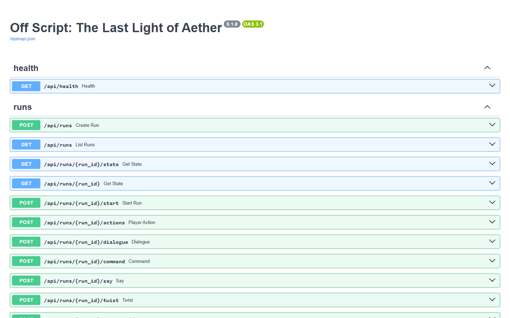
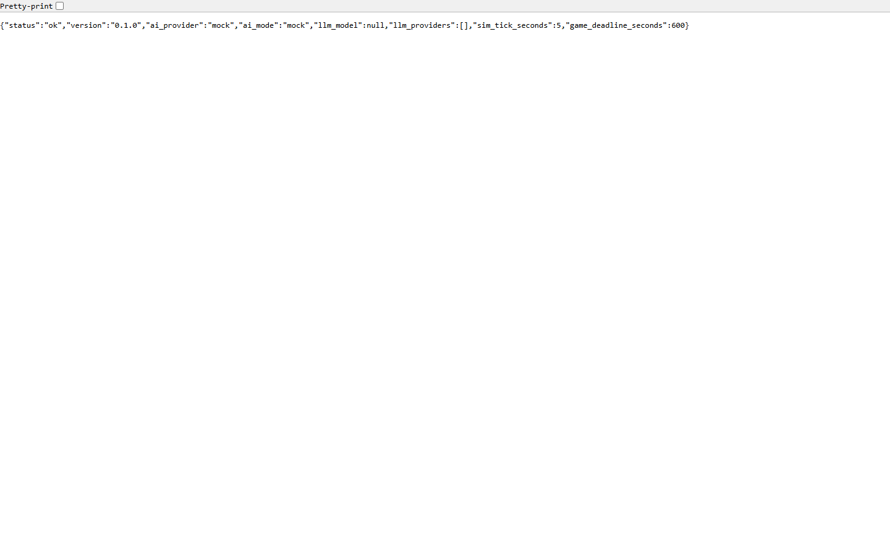
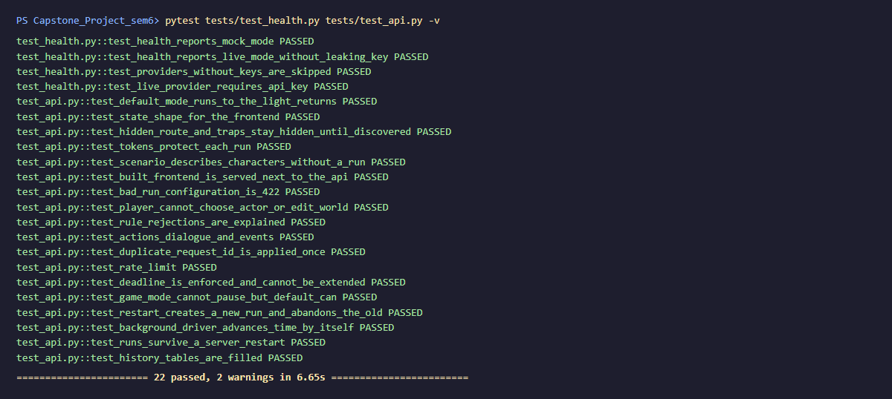

# Report 1: Devansh Patel

**Role:** Backend and API, project setup
**Build order:** Step 1 (project setup) and Step 7 (the full API)

> **In one line:** Devansh built the "front door" of the game. He set up the project, the game server, and all
> the web addresses (API endpoints) that the browser uses to start a game, send the player's moves and read
> what is happening.

---

## 1. What was asked, and what was built

| Task from the roles document | What was built | Status |
|---|---|---|
| Build the server and API that connect the agents, the story logic, the player and the map | A **FastAPI** server with 15 endpoints; one `RunManager` connects every part | Done |
| Provide endpoints for player actions, the world state and character decisions | `/actions`, `/dialogue`, `/command`, `/say`, `/twist`, `/state`, `/events`, `/characters` | Done |
| Set up the repository and version control, and merge the code of all members | Folder layout, Git repository, `.gitignore`, `.env` settings, `README.md`, one-click `share.ps1` | Partly: all files are staged in Git; the first commit is still to be made |

---

## 2. How it works, in easy words

Think of the backend as a restaurant kitchen and the API as the waiter.

- The browser (the customer) never goes into the kitchen. It sends a request to the waiter, for example
  *"Aria wants to walk to the Broken Bridge"*.
- The waiter takes it to the kitchen (the rules engine), which decides if it is allowed, and brings back the answer.
- Every game (a **run**) gets a secret **token**. Only someone with the token can control that run, so two
  players cannot interfere with each other's game.
- If a player clicks too fast, a **rate limiter** politely says "slow down" (HTTP 429).
- The same server also serves the built website, so one address (one ngrok link) is enough to play from a phone.

---

## 3. Code highlights

### a) Creating the server: [backend/app/main.py](../backend/app/main.py)

The whole application is built in one function. When it starts, it opens the database, connects to the AI
service and creates the `RunManager` that looks after every running game.

```python
def create_app(settings: Settings | None = None, llm: LLMService | None = None) -> FastAPI:
    settings = settings or get_settings()

    @asynccontextmanager
    async def lifespan(app: FastAPI) -> AsyncIterator[None]:
        repo = RunRepository(make_engine(settings.resolved_database_url))
        repo.create_schema()
        async with httpx.AsyncClient() as client:
            service = llm if llm is not None else LLMService.from_settings(settings, client)
            app.state.llm = service
            app.state.run_manager = RunManager(settings, repo, service)
            yield
            await app.state.run_manager.shutdown()
        repo.engine.dispose()

    app = FastAPI(title="Off Script: The Last Light of Aether", version=__version__, lifespan=lifespan)
    app.include_router(health.router)
    app.include_router(runs.router)
    app.include_router(scenario.router)
    # Serve the built frontend too, so one address (e.g. one ngrok tunnel) carries the game and its /api.
    if settings.serve_frontend and FRONTEND_DIST.is_dir():
        app.mount("/", StaticFiles(directory=FRONTEND_DIST, html=True), name="frontend")
    return app
```
*(shortened)*

### b) The player-action endpoint: [backend/app/api/runs.py](../backend/app/api/runs.py)

The browser sends a move such as `{"type": "move", "destination": "bridge"}`. The endpoint fills in *who* is
acting from the run itself (so a player can never act as someone else) and passes it on.

```python
@router.post("/{run_id}/actions", response_model=ActionResult)
async def player_action(body: PlayerActionRequest, m: ManagedRun = Depends(managed_run),
                        runs: RunManager = Depends(manager)) -> ActionResult:
    actor = m.world.story.player_character or ""
    fields = body.model_dump(exclude={"request_id"}, exclude_none=True)
    try:
        action = ProposedAction(actor=actor, **fields)
    except ValueError as e:
        raise HTTPException(status.HTTP_422_UNPROCESSABLE_ENTITY, str(e)) from None
    return await _guard(runs.act(m, action, body.request_id))
```

A rule rejection ("the bridge is broken") is a normal game answer: it returns `200` with `ok: false` and a
reason. HTTP errors are kept for real problems: 401 wrong token, 404 unknown run, 409 not allowed now,
422 bad request, 429 too many requests.

### c) Security: a secret token for each run: [backend/app/services/run_manager.py](../backend/app/services/run_manager.py)

Only a *hash* of the token is stored in the database, and it is compared in constant time.

```python
async def get(self, run_id: str, token: str | None) -> ManagedRun:
    managed = self._runs.get(run_id)
    if managed is None:
        loaded = self.repo.load(run_id)          # a run survives a server restart
        if loaded is None:
            raise RunNotFound(run_id)
        world, token_hash = loaded
        managed = self._runs.setdefault(run_id, self._wrap(world, token_hash))
    if token is None or not hmac.compare_digest(managed.token_hash, _hash(token)):
        raise NotAuthorized(run_id)
    self._ensure_driver(managed)
    return managed
```

### d) Settings and the health check: [backend/app/core/config.py](../backend/app/core/config.py), [backend/app/api/health.py](../backend/app/api/health.py)

All settings (AI provider, keys, timer length, speed limits) come from one `.env` file. API keys are stored as
`SecretStr`, so they are never printed or sent to the browser. The health check tells the UI whether the AI
is **mock** or **live**, so mock answers are never passed off as real AI.

```python
class HealthResponse(BaseModel):
    status: str
    version: str
    ai_provider: str
    ai_mode: str  # "mock" or "live" - shown in the UI so mock is never mistaken for a real LLM
    llm_model: str | None
    llm_providers: list[str]  # "name:model" in failover order; never includes keys
```

---

## 4. Screenshots

**All API endpoints (automatic documentation at `http://localhost:8000/docs`):**



**The health check answering in mock mode:**



---

## 5. Tests that check this part

`test_health.py` (4 tests) and `test_api.py` (18 tests): tokens are required, the 10-minute deadline cannot be
cheated, Game Mode cannot be paused, runs survive a server restart, and API keys never appear in any response.



---

## 6. Files

| File | What it does |
|---|---|
| [backend/app/main.py](../backend/app/main.py) | Creates the server |
| [backend/app/core/config.py](../backend/app/core/config.py) | All settings, loaded from `.env` |
| [backend/app/api/health.py](../backend/app/api/health.py) | `GET /api/health` |
| [backend/app/api/runs.py](../backend/app/api/runs.py) | All game endpoints |
| [backend/app/api/scenario.py](../backend/app/api/scenario.py) | Story, characters and places for the menus |
| [backend/app/schemas/](../backend/app/schemas/) | Shapes of every request and response |
| [backend/app/services/run_manager.py](../backend/app/services/run_manager.py) | Looks after running games: tokens, locks, saving, rate limits |
| [backend/app/services/rate_limit.py](../backend/app/services/rate_limit.py) | Token-bucket rate limiter |
| [share.ps1](../share.ps1), [.env.example](../.env.example), [README.md](../README.md), `.gitignore` | Project setup and sharing |

About **1,300 lines** of code.

## 7. If the mentor asks

- **Why FastAPI?** It is fast, written in Python like the rest of the game, and it writes the API documentation
  automatically (the screenshot above).
- **What stops a player from cheating through the API?** The actor is taken from the run, not from the request;
  every run needs its secret token; and every action still goes through the rules engine.
- **What happens if the server restarts during a game?** The run is loaded again from the database and the
  clock continues.
