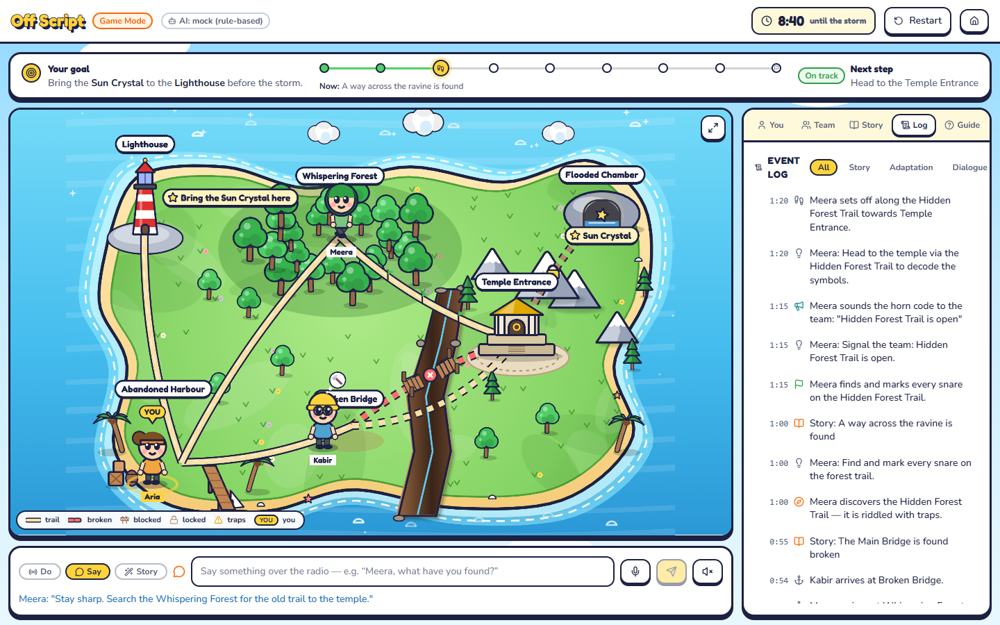
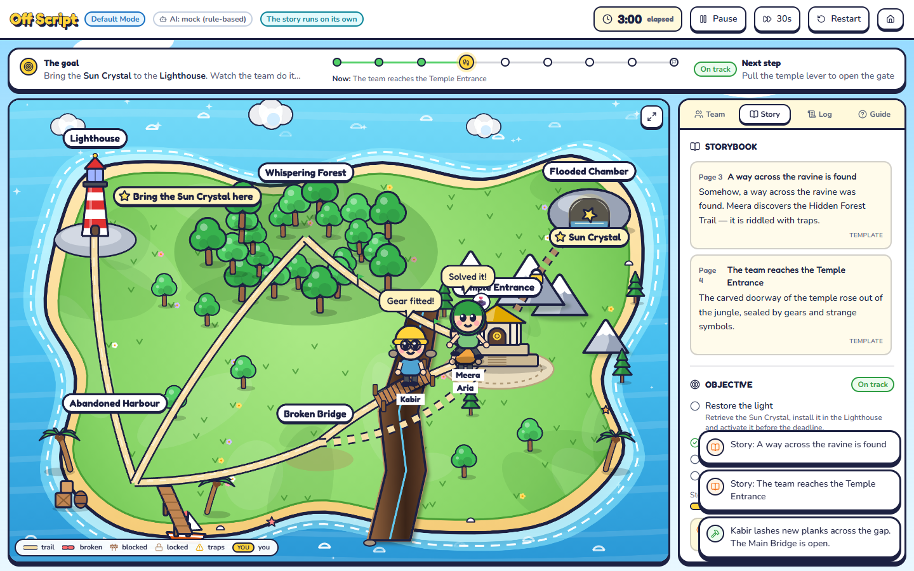
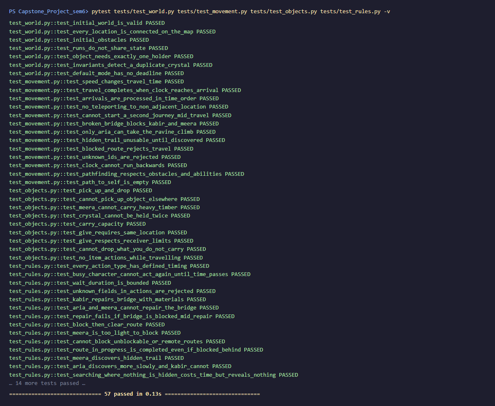

# Report 2: Devesh Singh

**Role:** Database and simulation loop
**Build order:** Step 2, the foundation that every other part reads from and writes to

> **In one line:** Devesh built the "memory and heartbeat" of the game: the database that stores the whole
> world, the rules that decide which moves are allowed, and the game clock that lets all characters act at
> the same time.

---

## 1. What was asked, and what was built

| Task from the roles document | What was built | Status |
|---|---|---|
| Design the database for characters, locations, objects, events and memories | A typed **world model** (Pydantic) plus 4 **SQLite** tables: runs, events, snapshots, memories | Done |
| Write the functions to read and update the world state | A **rules engine**: every change goes through `perform()`, which checks the action first. Movement, objects, invariant checks | Done |
| Build the game clock and event handling so that characters keep acting in parallel | One shared **timeline**: every action takes island time; arrivals and finished jobs are handled in time order; a real-time driver ticks the clock | Done |
| Support saving and resetting a game | Every change is saved; a refresh or server restart continues the same game; Restart starts a fresh run | Done |

---

## 2. How it works, in easy words

- **The world is one big object** called `WorldState`: places, routes, items, characters, the clock and the
  list of everything that has happened. It is the single source of truth.
- **Nobody edits the world directly.** A player or an AI character can only *propose* an action. The rules
  engine checks it ("Is Kabir at the right place? Is he busy? Does he have the timber?") and then starts it.
- **Every action takes time.** Walking the Coast Road takes 35 s, repairing the bridge 45 s. While a character
  is busy, they cannot start something else, so nobody can spam actions.
- **The clock moves forward step by step.** Each step, every idle character picks an action, then the clock
  moves to the next thing that finishes (someone arrives, a repair is done, the chamber floods). Because all
  three characters share one clock, they really do act in parallel.
- **Safety checks (invariants)** run all the time: there is exactly one Sun Crystal, and every item is held by
  exactly one person or lies in exactly one place.

---

## 3. Code highlights

### a) An item can never be in two places: [backend/app/models/world.py](../backend/app/models/world.py)

The database design itself prevents a bug: an item stores *either* where it lies *or* who carries it, never both.

```python
class WorldObject(BaseModel):
    id: str
    kind: str
    name: str
    portable: bool = True
    heavy: bool = False
    location_id: str | None = None
    carried_by: str | None = None

    @model_validator(mode="after")
    def _exactly_one_holder(self) -> "WorldObject":
        if (self.location_id is None) == (self.carried_by is None):
            raise ValueError(f"object {self.id} must have exactly one of location_id / carried_by")
        return self
```

### b) The rules engine, the only way to change the world: [backend/app/engine/rules.py](../backend/app/engine/rules.py)

```python
def perform(world: WorldState, action: ProposedAction) -> ActionResult:
    """Validate and start an action. Returns a rejection with a reason if it is not allowed."""
    if reason := check_action(world, action):
        return ActionResult.reject(reason)
    if action.type is ActionType.MOVE:
        return start_travel(world, action.actor, action.destination, action.route_id)

    rule = RULES[action.type]
    state = world.characters[action.actor]
    now = world.clock.now
    seconds = rule.seconds(world, action)
    ...
    state.activity = Activity(action=action, started_at=now, completes_at=now + seconds, deferred=rule.deferred)
    return ActionResult.success(message, *events, completes_at=now + seconds)
```
*(shortened)*

### c) The game clock: [backend/app/engine/timeline.py](../backend/app/engine/timeline.py)

The clock jumps from one due moment to the next and handles them in a fixed order, so every game can be
replayed exactly. The clock can never run backwards.

```python
def advance_clock(world, seconds, on_events=None) -> list[WorldEvent]:
    if seconds < 0:
        raise ValueError("the simulation clock cannot run backwards")
    target = world.clock.now + seconds
    events = []
    while (item := _next_due(world, target)) is not None:
        time, kind, _, subject = item
        world.clock.now = time
        if kind == _EFFECT:
            world.scheduled.remove(subject)
            new = apply_scheduled(world, subject)     # e.g. the chamber floods
        elif kind == _ARRIVAL:
            new = complete_travel(world, subject)     # someone arrives
        else:
            new = complete_activity(world, subject)   # a repair or puzzle finishes
        if on_events is not None and new:
            on_events(new)
        events += new
    world.clock.now = target
    return events
```

### d) One simulation step, all characters together: [backend/app/engine/simulation.py](../backend/app/engine/simulation.py)

```python
def run_tick(world, agents, until=None) -> list[WorldEvent]:
    end = world.clock.now + world.clock.tick_seconds if until is None else until
    events = []
    while True:
        for cid in sorted(agents):                 # every idle character acts...
            events += agents[cid].step(world)
        due = next_due_time(world, end)
        if due is None:
            events += advance_clock(world, end - world.clock.now, on_events)
            return events
        events += advance_clock(world, due - world.clock.now, on_events)   # ...then time moves on
```

The real-time driver in [run_manager.py](../backend/app/services/run_manager.py) calls this every few seconds
in the background, so the island keeps living even when the player does nothing.

### e) Saving a game: [backend/app/persistence/repository.py](../backend/app/persistence/repository.py)

```python
def save(self, world: WorldState, *, history: bool = False) -> None:
    """Store the latest snapshot and any new events; optionally also a history snapshot + memories."""
    with self.sessions.begin() as s:
        row = s.get(RunRow, world.run_id)
        self._append_events(s, world, after_seq=row.last_event_seq)   # events are append-only
        snapshot = world.model_dump(mode="json")
        row.snapshot = snapshot
        row.status = world.story.status.value
        row.sim_time = world.clock.now
        if history:
            s.add(SnapshotRow(run_id=world.run_id, sim_time=world.clock.now, snapshot=snapshot))
            self._save_memories(s, world)
```
*(shortened)*

**Database tables** ([tables.py](../backend/app/persistence/tables.py)):

| Table | Holds |
|---|---|
| `runs` | One row per game: mode, status, ending, clock, and the latest full snapshot |
| `run_events` | Every event in order (append-only history) |
| `run_snapshots` | Full snapshots every 60 s, for replay and analysis |
| `run_memories` | Important character memories (shared with Siddhank's part) |

---

## 4. Screenshots

**The event log: every line is an event the engine recorded, with its island time.**



**The clock at work: in "Watch the AI play" the three characters move at the same time (top right: simulated time).**



---

## 5. Tests that check this part

57 tests in `test_world.py`, `test_movement.py`, `test_objects.py` and `test_rules.py`: the island starts
correctly, walking takes the right time, nobody teleports, only Aria can climb, Meera cannot carry the heavy
timber, the crystal can never be held by two people, and the full mission can be completed.



---

## 6. Files

| File | What it does |
|---|---|
| [backend/app/models/world.py](../backend/app/models/world.py) | Places, routes, items, characters, clock, `WorldState` |
| [backend/app/models/enums.py](../backend/app/models/enums.py), [events.py](../backend/app/models/events.py), [actions.py](../backend/app/models/actions.py) | Shared vocabulary: action types, event kinds |
| [backend/app/persistence/tables.py](../backend/app/persistence/tables.py) | SQLite tables |
| [backend/app/persistence/repository.py](../backend/app/persistence/repository.py) | Save, load, list games |
| [backend/app/engine/rules.py](../backend/app/engine/rules.py) | The rules engine |
| [backend/app/engine/movement.py](../backend/app/engine/movement.py) | Travel times, route checks, shortest path |
| [backend/app/engine/objects.py](../backend/app/engine/objects.py) | Pick up, drop, give |
| [backend/app/engine/timeline.py](../backend/app/engine/timeline.py) | The game clock |
| [backend/app/engine/simulation.py](../backend/app/engine/simulation.py) | One simulation step |
| [backend/app/engine/invariants.py](../backend/app/engine/invariants.py) | Safety checks |
| [backend/app/engine/run.py](../backend/app/engine/run.py) | One game from start to end: modes, deadline, restart |

About **1,750 lines** of code.

## 7. If the mentor asks

- **Why SQLite?** It needs no separate server, it is one file, and it is enough for one game per player. The
  code uses SQLAlchemy, so moving to PostgreSQL later is a settings change.
- **How do characters act "in parallel" if the code runs one line at a time?** They share one simulated clock.
  Each character's action has a start and an end time, so three actions overlap in island time.
- **How do you know the world never breaks?** The invariant checks run in the tests after every step, and the
  database design itself makes some bugs impossible (an item with two owners cannot even be created).
