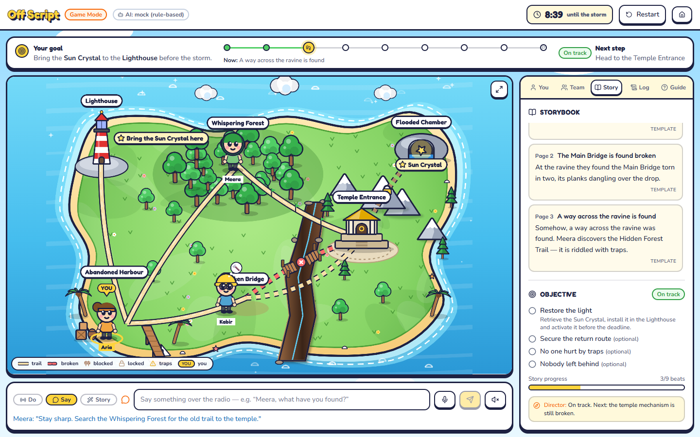
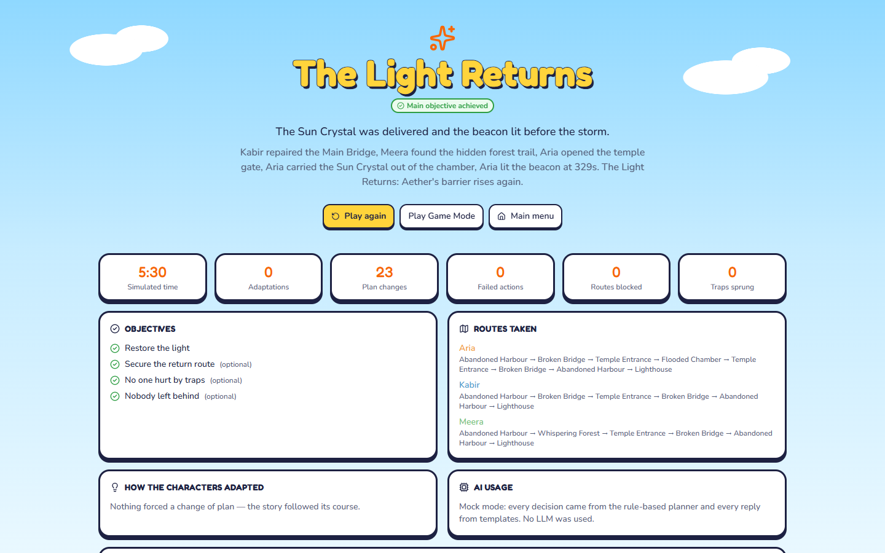
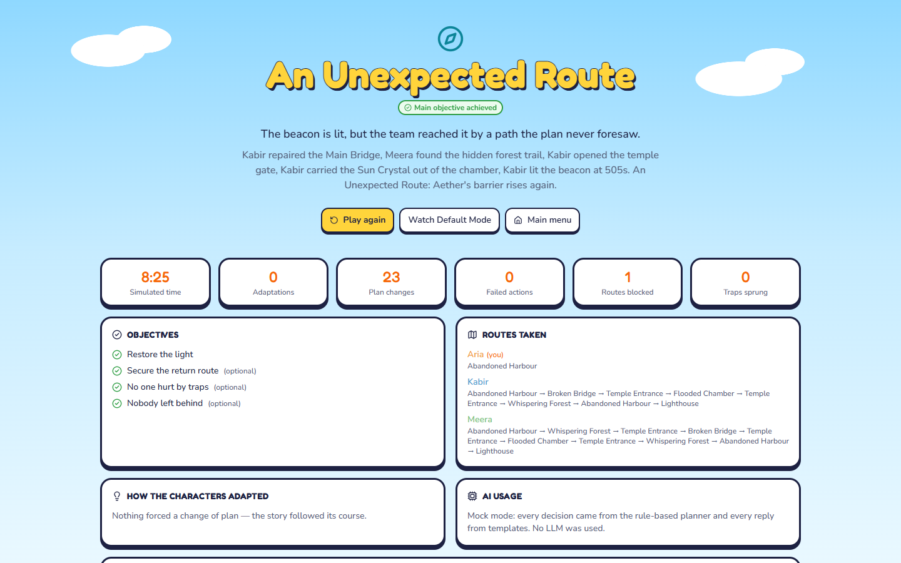
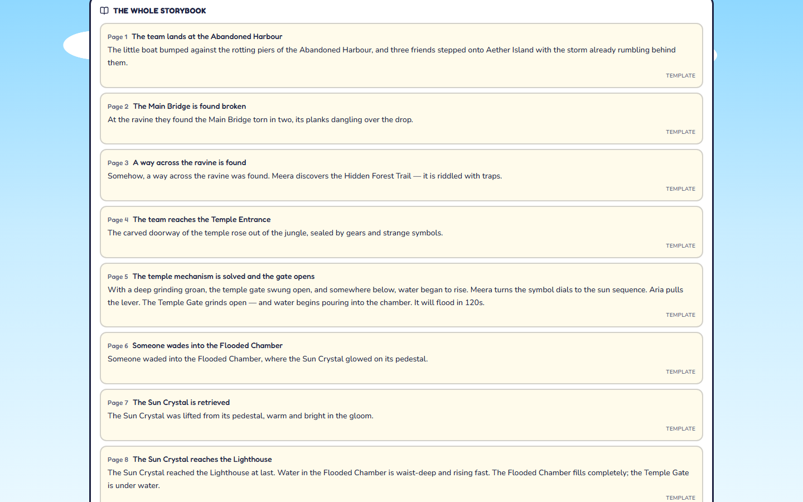
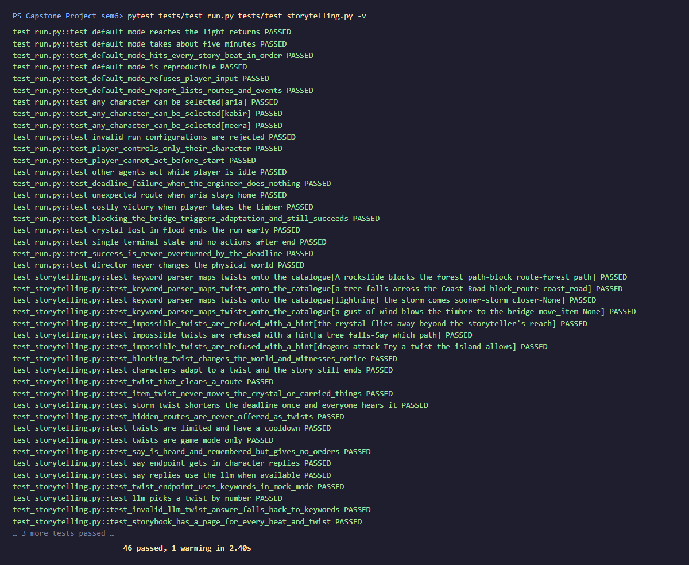

# Report 3: Anurag Patel

**Role:** Story design, goal tracking, adaptation logic, endings
**Build order:** Step 3 (the story and the island) and Step 6 (the Director on top of the agents)

> **In one line:** Anurag wrote the story and built the **Director**, a "film director" that knows the goal,
> watches how close the team is, notices when the player changes things, and decides which of the four
> endings happened.

---

## 1. What was asked, and what was built

| Task from the roles document | What was built | Status |
|---|---|---|
| Write the default story, the goal and the possible endings | *The Last Light of Aether*: 6 places, 7 routes, 3 characters, 4 items, 9 story moments, 4 endings | Done |
| Design the demonstration scenario (delivery of an item from Home to School) | Carry the **Sun Crystal** from the Flooded Chamber to the Lighthouse (same "deliver an item" idea, with more obstacles) | Done (changed scenario, see below) |
| Build goal tracking and detect when the player changes the situation | The Director tracks 9 story moments and 4 objectives, reviews every event, warns about the storm and notices when the team is stuck | Done |
| Build the logic that makes the characters change their strategy and continue toward the goal | Characters re-plan from what they know; a change of plan caused by outside news is counted as an **adaptation** | Done |
| Determine the outcome: success, failure or a different ending | 4 endings checked in a fixed order, plus an ending report (routes, adaptations, statistics) | Done |
| Extra | **Story twists**: the player can write a twist ("a tree falls on the Coast Road") and the island makes it happen | Done |

**Why the scenario changed:** Home → School has very few ways to go wrong. Aether Island keeps the same
structure (deliver an item from one place to another) but adds obstacles, so the characters' adaptation is
easy to see in a demo.

---

## 2. The story, in easy words

| | |
|---|---|
| **Goal** | Bring the Sun Crystal from the Flooded Chamber to the Lighthouse and light the beacon before the storm (10 minutes). |
| **Aria** the Explorer | Climbs, jumps gaps; fastest (×1.25). Cannot repair machines. |
| **Kabir** the Engineer | Repairs the bridge and the temple machine; carries the toolkit. Slowest (×0.8), cannot climb. |
| **Meera** the Scout | Finds hidden paths, marks traps, decodes symbols, signals the team. Cannot carry heavy things. |

**Obstacles:** the Main Bridge is broken (Kabir needs the timber) · a hidden forest trail full of traps (Meera
can find it) · the temple gate is locked by a gear-and-symbol puzzle · once the gate opens, the chamber
**floods after 2 minutes**.

| Ending | When it happens |
|---|---|
| **The Light Returns** | The beacon is lit on time, the normal way. |
| **A Costly Victory** | The beacon is lit, but something was lost (someone hurt by a trap, the bridge never repaired, someone trapped). |
| **An Unexpected Route** | The beacon is lit, but the team got there in a way the plan never foresaw. |
| **The Last Storm** | Failure: time runs out, or the crystal is lost in the flood. |

---

## 3. Code highlights

### a) The story written as data: [backend/app/engine/aether.py](../backend/app/engine/aether.py)

The whole island is plain data, so it is easy to read and change.

```python
ROUTES = [
    Route(id="cliff_stairs", name="Cliff Stairs", a=HARBOUR, b=LIGHTHOUSE, base_seconds=40),
    Route(id="coast_road", name="Coast Road", a=HARBOUR, b=BRIDGE, base_seconds=35),
    Route(id="main_bridge", name="Main Bridge", a=BRIDGE, b=TEMPLE, base_seconds=30,
          status=RouteStatus.BROKEN),
    Route(id="ravine_climb", name="Ravine Climb", a=BRIDGE, b=TEMPLE, base_seconds=50,
          requires_ability=Ability.CLIMB, blockable=False),
    Route(id="forest_path", name="Forest Path", a=HARBOUR, b=FOREST, base_seconds=40),
    Route(id="forest_trail", name="Hidden Forest Trail", a=FOREST, b=TEMPLE, base_seconds=70,
          hidden=True, hazard="traps", hazard_active=True, hazard_bypass=Ability.CLIMB,
          hazard_penalty_seconds=40),
    Route(id="temple_gate", name="Temple Gate", a=TEMPLE, b=CHAMBER, base_seconds=20,
          status=RouteStatus.LOCKED, blockable=False),
]

STORY_BEATS = [
    ("landing", "The team lands at the Abandoned Harbour"),
    ("bridge_broken", "The Main Bridge is found broken"),
    ("way_across", "A way across the ravine is found"),
    ("temple_reached", "The team reaches the Temple Entrance"),
    ("puzzle_solved", "The temple mechanism is solved and the gate opens"),
    ("chamber_entered", "Someone wades into the Flooded Chamber"),
    ("crystal_retrieved", "The Sun Crystal is retrieved"),
    ("return_journey", "The Sun Crystal reaches the Lighthouse"),
    ("beacon_lit", "The beacon is lit"),
]
```

### b) The flood, a timed obstacle: [backend/app/engine/obstacles.py](../backend/app/engine/obstacles.py)

Pulling the temple lever opens the gate *and* starts a 2-minute countdown. Two future events are put on the
game clock: a warning after 60 s and the flood after 120 s.

```python
def pull_lever_apply(world: WorldState, a: ProposedAction) -> list[WorldEvent]:
    now = world.clock.now
    world.temple_lock.gate_open = True
    world.routes[TEMPLE_GATE].status = RouteStatus.OPEN
    world.flood.floods_at = now + FLOOD_SECONDS
    world.scheduled.append(ScheduledEffect(time=now + FLOOD_WARNING_SECONDS, kind=FLOOD_WARNING))
    world.scheduled.append(ScheduledEffect(time=now + FLOOD_SECONDS, kind=CHAMBER_FLOODS))
    return [world.record(EventKind.GATE_OPENED,
        f"{world.name(a.actor)} pulls the lever. The Temple Gate grinds open — and water begins pouring "
        f"into the chamber. It will flood in {FLOOD_SECONDS}s.", ...)]
```
*(shortened)*

### c) The Director's job after every change: [backend/app/agents/director.py](../backend/app/agents/director.py)

The Director **only reads the world and writes story notes**. It may not move characters, move items, open
routes or force a success, so the story stays fair.

```python
def evaluate(self, world: WorldState) -> list[WorldEvent]:
    """Review the world after a change. Returns the narrative events it recorded."""
    if world.story.status is not RunStatus.RUNNING:
        return []
    events = []
    events += self._review_events(world)   # objectives: trap sprung? someone trapped? bridge fixed?
    events += self._update_beats(world)    # which of the 9 story moments are reached
    events += self._storm(world)           # warnings at 5, 2 and 1 minute left
    events += self._assess(world)          # on track / at risk / stalled
    if (ending := self._terminal(world)) is not None:
        events += self._finish(world, ending)
    return events
```

### d) Deciding the ending: [director.py](../backend/app/agents/director.py)

Endings are checked in a fixed order: the success types first, then failure. Once the beacon is lit, the
game can never turn into a failure afterwards.

```python
def _terminal(self, world: WorldState) -> tuple[EndingId, str] | None:
    lh = world.lighthouse
    deadline = world.clock.deadline
    if lh.activated and (deadline is None or (lh.activated_at or 0) <= deadline):
        failed = [o for o in world.story.objectives if o.optional and o.status is ObjectiveStatus.FAILED]
        if world.routes[MAIN_BRIDGE].status is not RouteStatus.OPEN:
            failed.append(self._objective(world, BRIDGE_RESTORED))  # never repaired by the end
        if failed:
            return EndingId.COSTLY_VICTORY, "The beacon is lit, but at a cost: ..."
        if self.signature(world) != DEFAULT_SIGNATURE:
            return EndingId.UNEXPECTED_ROUTE, "The beacon is lit, but the team reached it by a path the plan never foresaw."
        return EndingId.LIGHT_RETURNS, "The Sun Crystal was delivered and the beacon lit before the storm."
    crystal = world.objects[SUN_CRYSTAL]
    if world.flood.flooded and crystal.location_id == CHAMBER:
        return EndingId.LAST_STORM, "The Sun Crystal was lost when the chamber flooded; ..."
    if deadline is not None and world.clock.now >= deadline:
        return EndingId.LAST_STORM, f"Time ran out before the beacon was lit: ..."
    return None
```
*(shortened)*

"An Unexpected Route" works by comparing *how* the story went (who opened the gate, who took the crystal,
which route each character used) with the planned story:

```python
DEFAULT_SIGNATURE = {
    "gate_opened_by": ARIA,
    "crystal_taken_by": ARIA,
    "temple_routes": {ARIA: RAVINE_CLIMB, KABIR: MAIN_BRIDGE, MEERA: FOREST_TRAIL},
}
```

### e) Adaptation: telling "progress" apart from "changing the plan"

A character changes plan all the time ("bridge fixed, now cross it"). That is normal progress. It only counts
as an **adaptation** when the goal stays the same but the strategy changes *because of outside news*: an event
they saw, a message, or a failed action. This logic lives in the agent loop
([character_agent.py](../backend/app/agents/character_agent.py)), built together with Himanshu:

```python
adaptation = (
    old is not None and trigger is not None and old.goal == decision.goal
    and not progressed and old.status != "waiting"
)
...
if adaptation:
    text = f"{name} adapts — {trigger} New plan: {decision.summary}"
```

The adaptation count appears on the Team tab, in the event log ("Adaptation" filter) and in the ending report.

---

## 4. Screenshots

**Goal tracking: the goal bar (9 story moments, "On track", next step) and the Story tab with the objectives and the live storybook.**



**Ending A, "The Light Returns", with the ending report: objectives, the routes each character took, statistics.**



**Ending C, "An Unexpected Route": the player (Aria) stayed at the harbour and blocked the Coast Road, so Kabir
opened the gate and carried the crystal himself.**



**The storybook at the end: every story moment became a page.**



---

## 5. Tests that check this part

46 tests in `test_run.py` and `test_storytelling.py`, including one test for each ending:

| Ending / behaviour | Test |
|---|---|
| The Light Returns in about 5 minutes | `test_default_mode_reaches_the_light_returns`, `test_default_mode_takes_about_five_minutes` |
| A Costly Victory | `test_costly_victory_when_player_takes_the_timber` |
| An Unexpected Route | `test_unexpected_route_when_aria_stays_home` |
| The Last Storm | `test_deadline_failure_when_the_engineer_does_nothing`, `test_crystal_lost_in_flood_ends_the_run_early` |
| Adaptation | `test_blocking_the_bridge_triggers_adaptation_and_still_succeeds`, `test_characters_adapt_to_a_twist_and_the_story_still_ends` |
| The Director is fair | `test_director_never_changes_the_physical_world`, `test_success_is_never_overturned_by_the_deadline` |



---

## 6. Files

| File | What it does |
|---|---|
| [backend/app/engine/aether.py](../backend/app/engine/aether.py) | The island, characters, items, story moments, objectives |
| [backend/app/engine/ids.py](../backend/app/engine/ids.py) | Names of every place, character and item |
| [backend/app/engine/obstacles.py](../backend/app/engine/obstacles.py) | Bridge, traps, temple puzzle, flood, lighthouse |
| [backend/app/models/story.py](../backend/app/models/story.py), [obstacles.py](../backend/app/models/obstacles.py) | Story state: moments, objectives, ending, storybook |
| [backend/app/agents/director.py](../backend/app/agents/director.py) | The Director |
| [backend/app/agents/storyteller.py](../backend/app/agents/storyteller.py) | Story twists written by the player |

About **1,130 lines** of code.

## 7. If the mentor asks

- **How does the story reach its goal if the player disrupts it?** The characters re-plan from what they know,
  and the Director keeps track of the goal; whatever happens, one of the four endings is reached.
- **Can the Director cheat to save the story?** No. It can only read the world and write story notes. A test
  runs the Director and checks that nothing physical in the world (routes, items, characters, minds) changed.
- **Why not Home → School?** Same structure (deliver an item), but more obstacles, so adaptation is visible.
