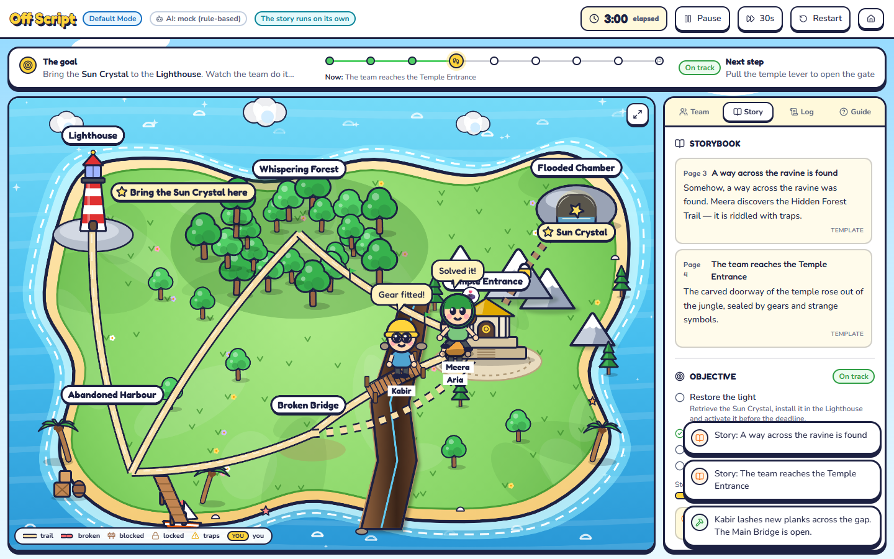
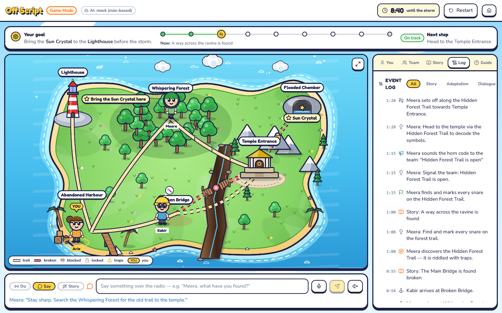
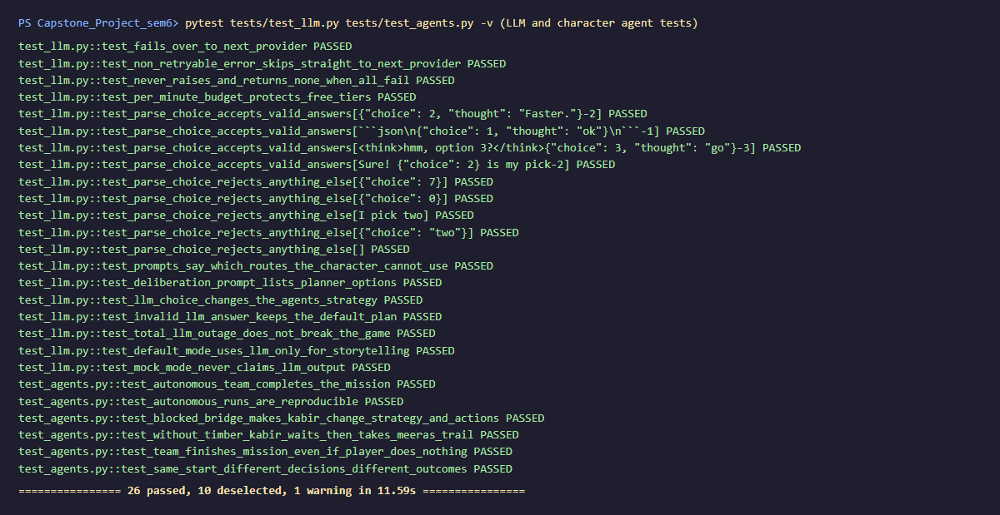

# Report: Himanshu Srivastava

Role: LLM integration and character agents

Project: Off Script: The Last Light of Aether (CSE339 Capstone)

## My work

My part was to connect the game to a large language model and to build the character agents, so that Aria, Kabir and Meera can decide what to do on their own.

### 1. Connecting the AI (LLM)

- Connected the game to three free AI providers: Groq, Google Gemini and OpenRouter.
- All three use the same OpenAI-style request, so one service works with all of them.
- The game tries them in order. If one fails or reaches its free limit, the next one is used.
- If none of them answers, the game does not stop. The characters use a rule-based planner instead.
- We did not train any model. We use ready-made models and guide them with prompts.

### 2. Personality and goals of each character

- Aria (Explorer): brave and fast, can climb, cannot repair machines.
- Kabir (Engineer): careful and logical, can repair the bridge and the temple mechanism, but is slow and cannot climb.
- Meera (Scout): finds hidden paths, marks traps, decodes symbols, cannot carry heavy things.
- These details go into every prompt, so each character decides and talks in its own way.

### 3. The decision loop

- Every character repeats the same steps: look around, decide the next step, ask the rules engine to do it.
- A rule-based planner first makes a short list of valid options, for example "repair the bridge" or "go round through the forest".
- When something important happens (a blocked road, a failed action), the AI picks one option and gives a one-line reason.
- The AI cannot invent a new action. It can only choose from the list.
- I check the AI's answer. If it is not a valid option, the character keeps its normal plan.
- The rules engine checks the action again before it happens, so characters can never break the game rules.

### 4. Controlling cost and speed

- At most 10 AI calls per minute, to stay inside the free limits.
- At most 30 AI decisions per character in one game.
- A strategy chosen by the AI is kept for 90 seconds instead of asking again.
- The AI is asked only when something important happens.
- The game never waits for the AI. Characters keep acting while the answer comes in the background.
- In Watch mode no AI decisions are used, so that mode always plays out the same way.

## Testing

- I wrote 26 automatic tests for my part, and all of them pass.
- They check that:
  - the game switches to the next provider when one fails
  - the per-minute limit works
  - wrong AI answers are rejected
  - the AI's choice really changes a character's plan
  - the game still finishes with no AI at all
  - Kabir changes his plan when the bridge is blocked

## Screenshots

In Watch mode the three characters decide and move by themselves, each following its own plan at the same time.

The event log shows the decisions the characters make, for example Meera deciding to go to the temple through the hidden forest trail.

My tests running and passing.

## Files I worked on

- backend/app/services/llm.py (connection to the AI providers)
- backend/app/agents/character_agent.py (decision loop of each character)
- backend/app/agents/planner.py (options for each character)
- backend/app/agents/view.py (helper for the planner)
- backend/app/agents/prompts.py (decision prompt and answer checking)
- backend/app/engine/aether.py (character personalities and goals)
- backend/app/services/run_manager.py (asking the AI in the background)
