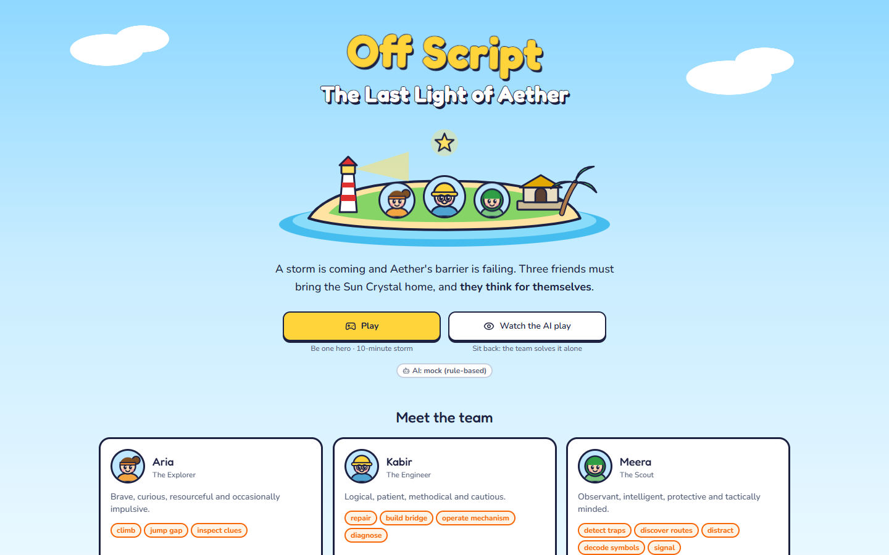
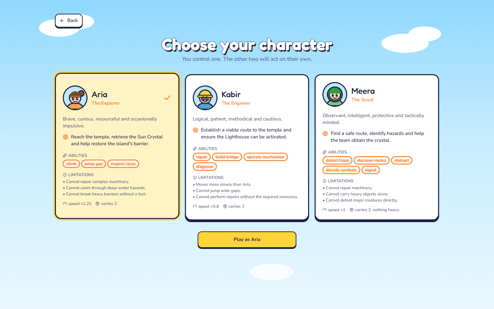
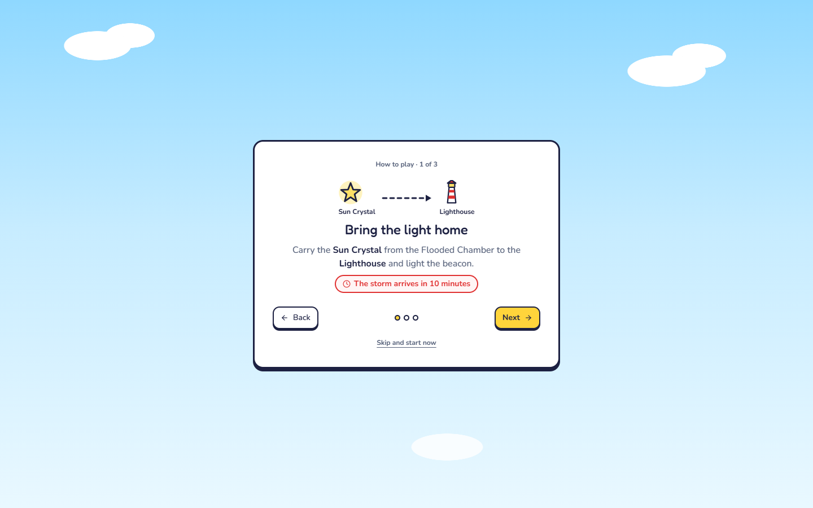
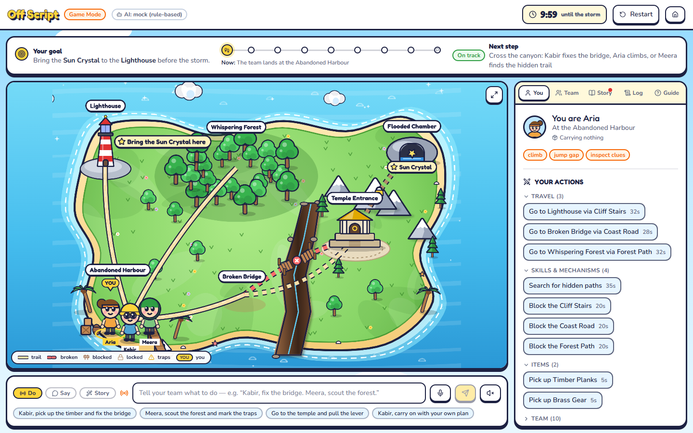
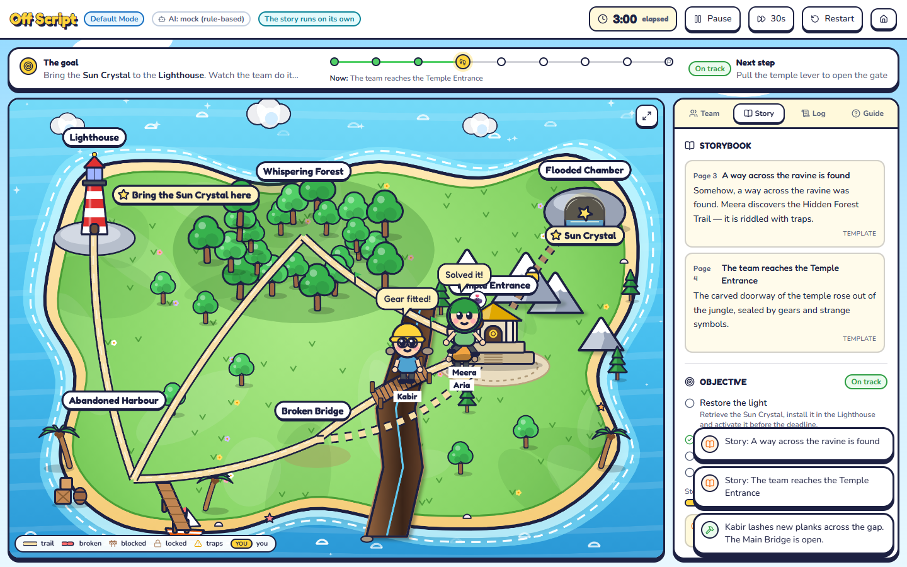
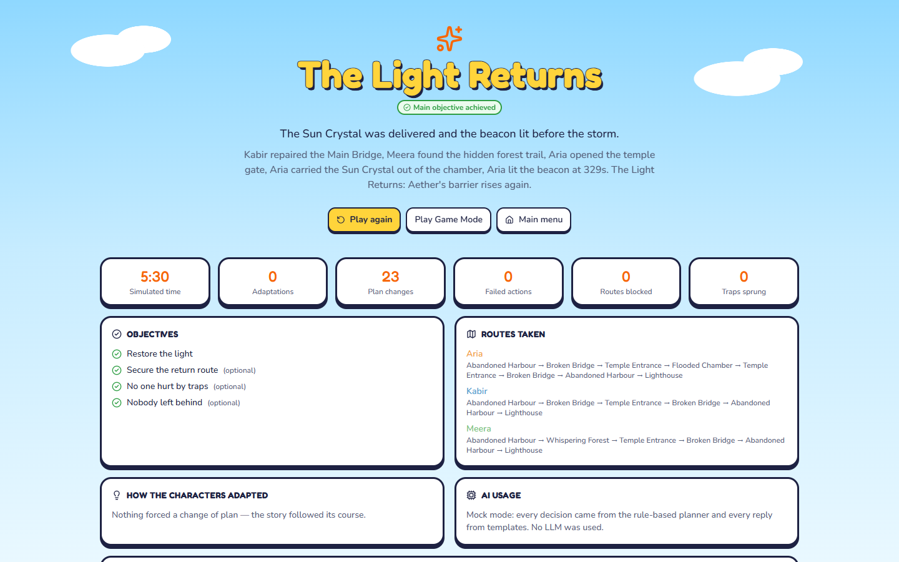
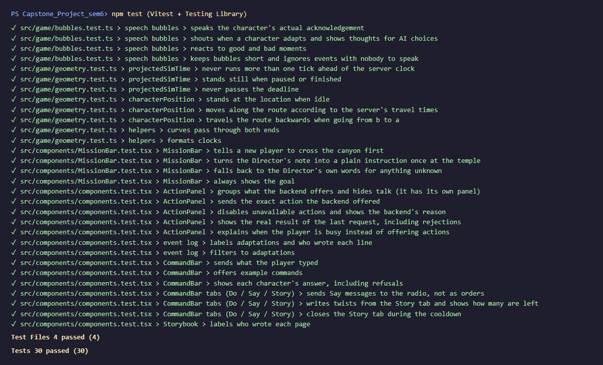

# Report 6: Aniket Mondal

**Role:** 2D map, user interface, player controls
**Build order:** Step 8, the last layer, because the screen only *shows* what the backend reports

> **In one line:** Aniket built everything you see and click: the cartoon island map with walking characters,
> the menus, the buttons to play, the voice commands, and the ending screen.

---

## 1. What was asked, and what was built

| Task from the roles document | What was built | Status |
|---|---|---|
| Draw the 2D map with Home, School, Hospital, Park, Market and the rooms within them | A cartoon map of **Aether Island** drawn with Phaser 3: Harbour, Lighthouse, Broken Bridge, Whispering Forest, Temple Entrance, Flooded Chamber, with sea, canyon, forest, mountains and storm clouds (the places follow the new scenario) | Done |
| Display moving character markers that reflect the world state | Chibi characters walk along the routes using the server's travel times; speech bubbles; a "YOU" arrow; the storm wall creeps in as time runs out | Done |
| Build the player's controls: move, talk, deliver, block and ignore | Action panel (go to, pick up, give, install the crystal, repair, block or clear a route, ask for help, wait), Talk panel, and a **Do / Say / Story** command bar with a **microphone** | Done |
| Build the start, reset and status screens | Main menu, character select, 3-step how-to-play, game screen with a goal bar and 5 tabs (You, Team, Story, Log, Guide), Restart button, ending screen | Done |

The roles document's control names map like this: **move** = travel buttons · **talk** = Talk panel and radio ·
**deliver** = pick up / give / install the Sun Crystal · **block** = block a route · **ignore** = wait, or
simply do nothing (the team carries on alone).

---

## 2. How it works, in easy words

- The browser is a **TV screen, not the game itself**. It asks the server "what is happening?" every 0.6 seconds
  and draws the answer. It never decides anything on its own.
- So that walking looks smooth between two answers, the map **predicts** where each character is on its route,
  but never more than one clock tick ahead of the server, so it can never show something that hasn't happened.
- The buttons in the action panel come **from the server**. If an action is not allowed right now, it is greyed
  out with the server's reason ("Timber Planks is not here").
- The microphone uses the browser's built-in speech recognition (Chrome/Edge), and the speaker button reads
  the characters' replies aloud. Both are free and need no extra service.

---

## 3. Code highlights

### a) Keeping the screen in sync with the server: [frontend/src/hooks/useRun.ts](../frontend/src/hooks/useRun.ts)

```ts
const POLL_MS = 600;

/** Keeps a local mirror of one run by polling the backend. Never changes game state on its own. */
export function useRun(session: RunSession | null): RunHandle {
  ...
  const refresh = useCallback(async () => {
    if (!session) return;
    const next = await api.state(session);
    if (next.last_event_seq > lastSeq.current) {
      const fresh = await api.events(session, lastSeq.current);   // only the new events
      lastSeq.current = Math.max(lastSeq.current, fresh.last_event_seq);
      setEvents((prev) => {
        const newest = prev.length ? prev[prev.length - 1].seq : 0;
        return [...prev, ...fresh.events.filter((e) => e.seq > newest)].slice(-MAX_EVENTS);
      });
    }
    setState(next);
    setReceivedAt(Date.now());
  }, [session]);
```
*(shortened)*

### b) Smooth movement that never runs ahead of the server: [frontend/src/game/geometry.ts](../frontend/src/game/geometry.ts)

```ts
/**
 * Best estimate of the backend's simulated clock right now, for smooth animation only.
 * It never runs more than one tick ahead of the last authoritative value, and it stands still
 * when the run is paused or over - so the map can lag the backend but never invent progress.
 */
export function projectedSimTime(state: StateView, receivedAtMs: number, nowMs: number): number {
  const { clock, run } = state;
  if (run.status !== "running" || run.paused) return clock.now;
  const elapsed = Math.max(0, (nowMs - receivedAtMs) / 1000) * run.sim_speed;
  let t = clock.now + Math.min(elapsed, clock.tick_seconds);
  if (clock.deadline !== null) t = Math.min(t, clock.deadline);
  return t;
}
```

### c) Drawing the walking characters each frame: [frontend/src/game/IslandScene.ts](../frontend/src/game/IslandScene.ts)

```ts
update(time: number, delta: number): void {
  const { state, receivedAt } = this.frame;
  const sim = projectedSimTime(state, receivedAt, Date.now());
  for (const c of state.characters) {
    const t = this.toons.get(c.id);
    const target = characterPosition(c, state, sim, locations, routes);   // where they should be
    const nx = Phaser.Math.Linear(t.root.x, target.x, 0.2);              // glide there smoothly
    const ny = Phaser.Math.Linear(t.root.y, target.y, 0.2);
    const dx = nx - t.lastX;
    if (Math.abs(dx) > 0.2) t.art.setScale(dx < 0 ? -TOON : TOON, TOON); // face the way they walk
    t.root.setPosition(nx, ny);
    t.art.y = t.moving ? -Math.abs(Math.sin(t.phase)) * 5 : Math.sin(time / 450 + nx) * 1.1;   // bounce
    this.drawLimbs(t);
    this.drawFace(t, blink);
  }
  // The storm wall creeps in from the east as the deadline nears ...
}
```
*(shortened)*

### d) The action panel shows only what the server allows: [frontend/src/components/ActionPanel.tsx](../frontend/src/components/ActionPanel.tsx)

```ts
const GROUPS: { title: string; types: string[] }[] = [
  { title: "Travel", types: ["move"] },
  { title: "Skills & mechanisms", types: [
    "repair_bridge", "clear_route", "block_route", "discover_route", "detect_traps", "repair_mechanism",
    "decode_symbols", "pull_lever", "repair_lighthouse", "install_crystal", "activate_lighthouse", "signal",
  ] },
  { title: "Items", types: ["pick_up", "drop", "give"] },
  { title: "Team", types: ["ask", "request_help"] },
  { title: "Other", types: ["inspect", "wait"] },
];

export function groupActions(options: ActionOption[]) {
  // Talking has its own panel; everything else the backend offered is grouped here.
  const usable = options.filter((o) => o.action.type !== "talk");
  return GROUPS.map((g) => ({ title: g.title, options: usable.filter((o) => g.types.includes(o.action.type)) }))
    .filter((g) => g.options.length > 0);
}
```

---

## 4. Screenshots

**Start screen:**



**Character select:**



**How-to-play briefing before the clock starts:**



**The game screen: goal bar on top, the island map, the action panel on the right, and the Do / Say / Story command bar with the microphone at the bottom.**



**Characters walking on their own in "Watch the AI play" mode:**



**Ending screen with the report:**



---

## 5. Tests that check this part

30 frontend tests (Vitest + Testing Library): the action panel groups and greys out actions correctly, the
command bar sends what was typed and shows refusals, the Story tab respects the cooldown, speech bubbles
appear at the right moments, and characters move along the route according to the server's travel times.



---

## 6. Files

| Folder / file | What it does |
|---|---|
| [frontend/src/game/IslandScene.ts](../frontend/src/game/IslandScene.ts), [scenery.ts](../frontend/src/game/scenery.ts) | The Phaser island map, scenery and characters |
| [frontend/src/game/geometry.ts](../frontend/src/game/geometry.ts), [bubbles.ts](../frontend/src/game/bubbles.ts) | Positions on routes, speech bubbles |
| [frontend/src/pages/](../frontend/src/pages/) | Main menu, character select, game screen, ending screen |
| [frontend/src/components/](../frontend/src/components/) | Action panel, command bar, team, story, log, guide, goal bar, top bar |
| [frontend/src/hooks/useRun.ts](../frontend/src/hooks/useRun.ts), [useSpeech.ts](../frontend/src/hooks/useSpeech.ts) | Talking to the server; voice in and out |
| [frontend/src/services/api.ts](../frontend/src/services/api.ts), [types/](../frontend/src/types/) | Typed API client |

About **3,900 lines** of TypeScript, the largest part of the project.
Built with React 19, TypeScript, Vite, Phaser 3.90 and Tailwind CSS 4.

## 7. If the mentor asks

- **Why does the map not cheat or show wrong positions?** It only draws what the server reports, and its
  smoothing never goes more than one tick ahead of the server's clock.
- **Does it work on a phone?** Yes, the layout adapts; through `share.ps1` (ngrok) the game opens on any phone.
  Turning the phone sideways or using the full-screen map button works best.
- **Why are the map places different from the roles document?** The team changed the demo from Home → School
  to Aether Island; the map follows the new story.
