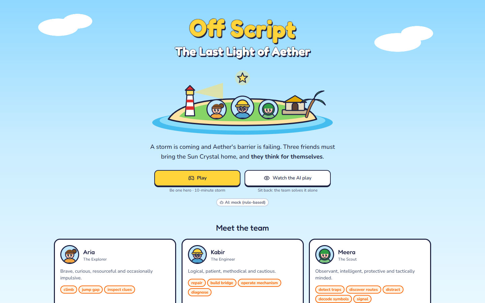

# Team Reports: Off Script, The Last Light of Aether

**Course:** Capstone Project (CSE339) · **Problem statement:** SIH26195 · **Date:** 30 October 2026

This folder has one report for each of the six team members. Each report says what the member was asked
to do (from the *Roles and Responsibilities* document), what they built, a few short pieces of their code,
screenshots of the working game, and the automatic tests that check their part.

---

## 1. The project in one minute

We built a **2D cartoon adventure game in which the characters are run by AI**. They make their own plans,
talk to each other, and change their plans when something goes wrong, but they can never break the rules
of the game.

- **Story:** Aether Island's magic barrier is failing and a storm is coming. Three friends, **Aria** (Explorer),
  **Kabir** (Engineer) and **Meera** (Scout), must carry the **Sun Crystal** from the Flooded Chamber to the
  **Lighthouse** and light the beacon.
- **Two modes:** *Watch the AI play* (nobody plays; the team solves it alone) or *Play* (you are one hero and
  have 10 minutes; the other two think for themselves).
- **Four endings:** The Light Returns · A Costly Victory · An Unexpected Route · The Last Storm (failure).



> **Change from the roles document:** the document describes a demo of delivering an item from *Home to
> School* on a map with Home, School, Hospital, Park and Market. The team chose the **Aether Island** adventure
> instead, because it shows the same idea more clearly (a goal, obstacles, and characters who adapt). The
> structure is the same: an item (the Sun Crystal) is carried from one place (the Flooded Chamber) to
> another (the Lighthouse). Every responsibility in the document still applies.

---

## 2. Who did what

| No. | Member | Role | Report |
|---|---|---|---|
| 1 | Devansh Patel | Backend and API, project setup | [01_Devansh_Patel.md](01_Devansh_Patel.md) |
| 2 | Devesh Singh | Database and simulation loop | [02_Devesh_Singh.md](02_Devesh_Singh.md) |
| 3 | Anurag Patel | Story design, goal tracking, adaptation logic, endings | [03_Anurag_Patel.md](03_Anurag_Patel.md) |
| 4 | Siddhank Kashyap | Memory, knowledge, relationships and dialogue | [04_Siddhank_Kashyap.md](04_Siddhank_Kashyap.md) |
| 5 | Himanshu Srivastava | LLM integration and character agents | [05_Himanshu_Srivastava.md](05_Himanshu_Srivastava.md) |
| 6 | Aniket Mondal | 2D map, user interface, player controls | [06_Aniket_Mondal.md](06_Aniket_Mondal.md) |

PDF copies of every report are in the [pdf/](pdf/) folder.

---

## 3. The order in which the game was built

The reports are numbered in the order the parts were built, because each part stands on the one before it.

| Step | What was built | Why it comes here | Member |
|---|---|---|---|
| 1 | Project setup: folders, server skeleton, settings, health check | Everyone needs a place to put their code and a server to run it | Devansh |
| 2 | Database, world state, rules engine and game clock | The **shared database schema had to be agreed first**, since every member reads and writes it | Devesh |
| 3 | The story: island, characters, obstacles, goal, endings | Now that the world can be stored, we fill it with our scenario | Anurag |
| 4 | Memory and knowledge of each character, trust, dialogue | Characters must *know* things before they can decide anything | Siddhank |
| 5 | Character agents, the planner and the LLM connection | Agents decide using the memory from step 4, inside the world from steps 2–3 | Himanshu |
| 6 | The Director (goal tracking, adaptation, endings) on top of the agents | It watches the agents and the story together | Anurag |
| 7 | The full API: runs, actions, dialogue, commands, saving | Connects the finished backend to the outside world | Devansh |
| 8 | The 2D map, screens and player controls | The user interface shows what the backend reports | Aniket |

### How the parts connect

```
 Player (click / type / speak)                                        [Aniket]
        │
        ▼
 Game server and API  (FastAPI)                                       [Devansh]
        │
        ▼
 Rules engine + game clock  ◄────────►  World state in the database   [Devesh]
        ▲                                        ▲
        │ proposes an action                     │ reads beliefs
 Character agents + LLM  ◄──────────────►  Memory, knowledge, trust   [Himanshu] [Siddhank]
        ▲
        │ watches progress, decides the ending
 Story Director                                                        [Anurag]
```

**The key idea:** the AI never changes the world directly. The rules engine lists the moves that are possible
right now, the AI *chooses* one, and the rules check it again. So characters can surprise you, but they
cannot cheat (Kabir cannot climb, and there is only ever one Sun Crystal).

---

## 4. Numbers

| What | Count |
|---|---|
| Automatic tests (all passing on 30 Oct 2026) | **231** (201 backend + 30 frontend) |
| Source files (Python + TypeScript) | 82 |
| Free AI providers, with automatic switching | 3 (Groq, Google Gemini, OpenRouter) |
| Places / routes on the island | 6 / 7 |
| Endings | 4 |

## 5. How to run the game for the demo

```powershell
# Backend (port 8000)
cd backend
.venv\Scripts\python -m uvicorn app.main:app --port 8000

# Frontend (port 5173), in a second terminal
cd frontend
npm run dev
```

Open http://localhost:5173. With no AI keys the game runs in **mock mode** (rule-based characters, template
replies), which is how the screenshots in these reports were taken. `.\share.ps1` puts the game online through
ngrok so it can be opened on a phone.

**Run all tests:** `cd backend; .venv\Scripts\python -m pytest` and `cd frontend; npm test`.
